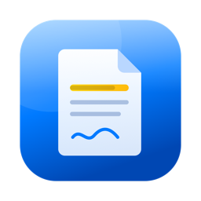
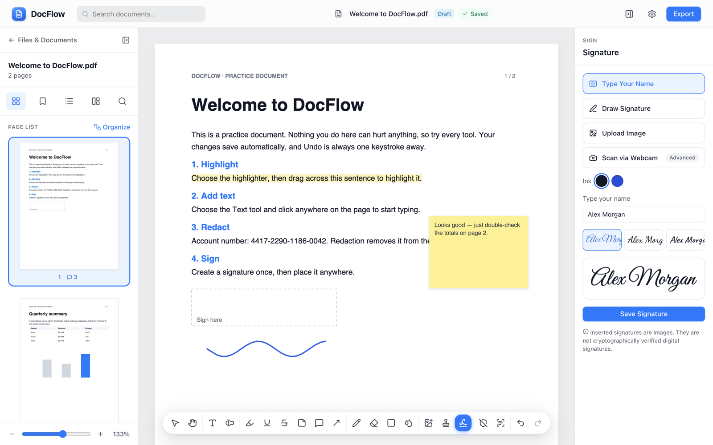
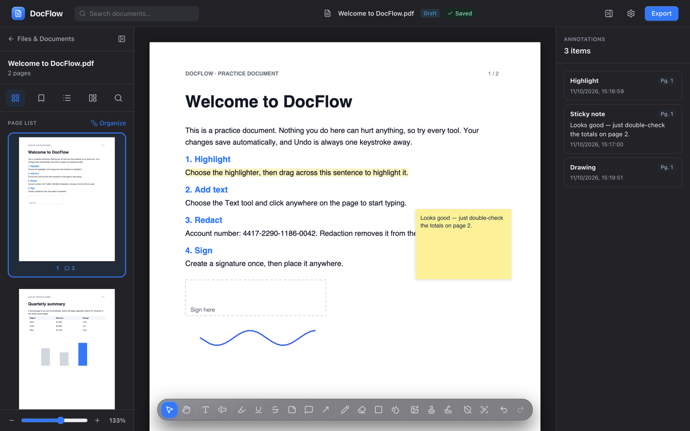
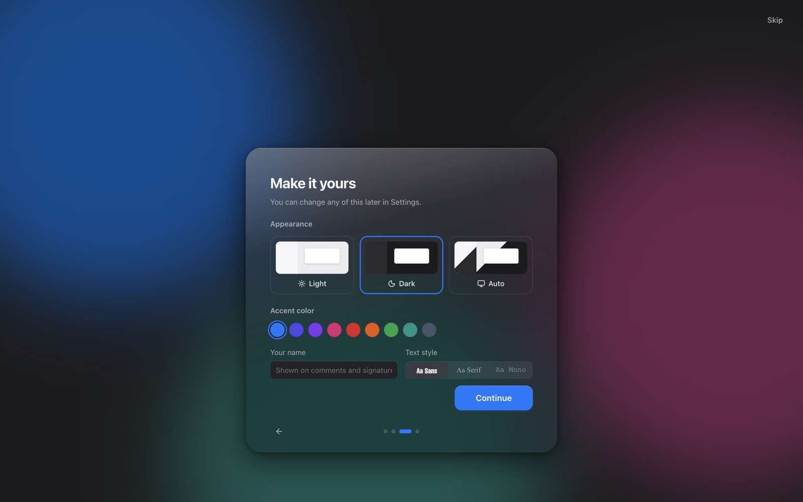

<p align="center">
  
</p>

<h1 align="center">DocFlow</h1>

<p align="center">
  Read, edit, sign and securely redact PDFs — entirely on your Mac.<br />
  No account. No uploads.
</p>

<p align="center">
  <a href="https://github.com/lakshhaybedi/docflow/releases/latest"><b>Download for Mac</b></a> ·
  <a href="https://lakshhaybedi.github.io/docflow/">Website</a> ·
  <a href="#install">Install</a> ·
  <a href="#build-from-source">Build from source</a>
</p>

<p align="center">
  
</p>

## Features

| | |
|---|---|
| **Annotate** | Highlight, underline, strikethrough, sticky notes, comments, callout arrows, freehand drawing, shapes, stamps and stickers |
| **Edit text** | Add text with font, size, weight, color, alignment, line height and letter spacing — or retouch existing lines |
| **Sign** | Type, draw, upload or scan a signature from paper with your webcam; save it and reuse it |
| **Redact for real** | Removes the underlying content from the file and verifies it's gone before reporting success |
| **OCR** | Recognize text on scanned pages, copy it, or make the document searchable |
| **Organize** | Thumbnails, bookmarks, outline, search with match-case / whole-word, drag-to-reorder pages |
| **Manage files** | Merge, compress, duplicate, rename, star, label (Draft, Review, Approved…), folders and bulk actions |
| **Export** | PDF, PNG or JPG, custom page ranges, quality settings, AES-256 password protection, real PDF comments |
| **Make it yours** | Light / dark / auto, any accent color, default fonts and styles, sepia and night page tones |
| **Feels like a Mac app** | Glass toolbar, smooth motion, native menus, ⌘O / Open With, guided first-run tour |

<p align="center">
  
  
</p>

## Install

1. Download `DocFlow-x.y.z-arm64.dmg` from the [latest release](https://github.com/lakshhaybedi/docflow/releases/latest).
2. Open it and drag **DocFlow** into **Applications**.
3. The first time, **right-click DocFlow › Open** and confirm.
   If there's no Open button, go to **System Settings › Privacy & Security** and choose **Open Anyway**.

DocFlow isn't notarized by Apple yet, which is why macOS asks once.
Requires **macOS 13 Ventura or later** on **Apple Silicon**.

## Build from source

Requires Node.js 20 or later.

```bash
git clone https://github.com/lakshhaybedi/docflow.git
cd docflow
npm install
```

| Command | What it does |
|---|---|
| `npm run dev` | Web version at http://localhost:5180 |
| `npm run app` | Build and launch the macOS app |
| `npm run dist:mac` | Build `release/DocFlow-<version>-arm64.dmg` |
| `npm run build` | Type-check and build the web bundle into `dist/` |

## Privacy

Documents are stored in the app's local storage and processed on-device. Nothing is uploaded, there's no account and no analytics.
The only network requests are ones you start:

- **OCR** downloads the Tesseract engine and English language data from cdn.jsdelivr.net on first use.
- **Stock image search** sends your search terms to [Openverse](https://openverse.org).

## How it works

- **Rendering** — [PDF.js](https://mozilla.github.io/pdf.js/) draws pages and the selectable text layer. Pages render lazily as you scroll.
- **Writing** — [pdf-lib](https://github.com/cantoo-scribe/pdf-lib) flattens annotations into the PDF, merges, compresses and encrypts. Annotations are stored in page coordinates, so they're zoom-independent and map 1:1 to export.
- **Redaction** — each redacted page is rebuilt as an image with the areas painted out, in a brand-new document, so the original text and graphics aren't carried over. The output is re-opened and checked for leftover text before success is reported.
- **Desktop** — an [Electron](https://www.electronjs.org/) shell serves the web build from a private `app://` origin with a strict content security policy, sandboxed renderer and a minimal preload bridge.

```
src/
  lib/          pdf.ts (rendering, search) · pdfwrite.ts (export, redaction, OCR layer) · store.ts (IndexedDB) · prefs.ts
  editor/       editor shell, viewer, annotation layer, toolbar, side panels, export dialog, page organizer
  dashboard/    file management and quick tools (merge, compress, convert)
  onboarding/   welcome flow, guided tour, practice document
  ui/           shared components, settings, tooltips, prompts
  apple.css     glass materials and motion
electron/       macOS shell (main process + preload)
docs/           landing page (GitHub Pages)
```

## Known limitations

- **Redacted pages become images.** Their remaining text isn't selectable until you run OCR on them.
- **Editing existing text covers the original.** The original stays in the file underneath (the app says so); use Redact to remove it.
- **Added text uses the PDF standard fonts** (Helvetica, Times, Courier), so Latin characters only.
- **Word and PowerPoint export** aren't available yet; PDF, PNG and JPG are.
- **Not notarized** yet, and builds are Apple Silicon only.
